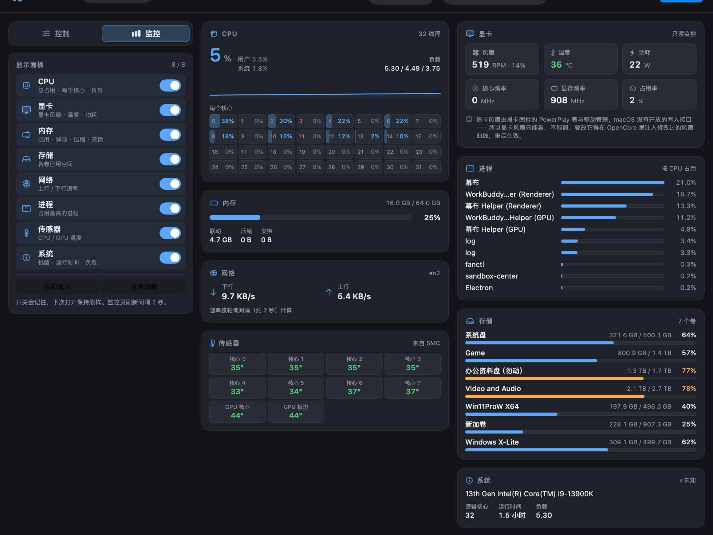
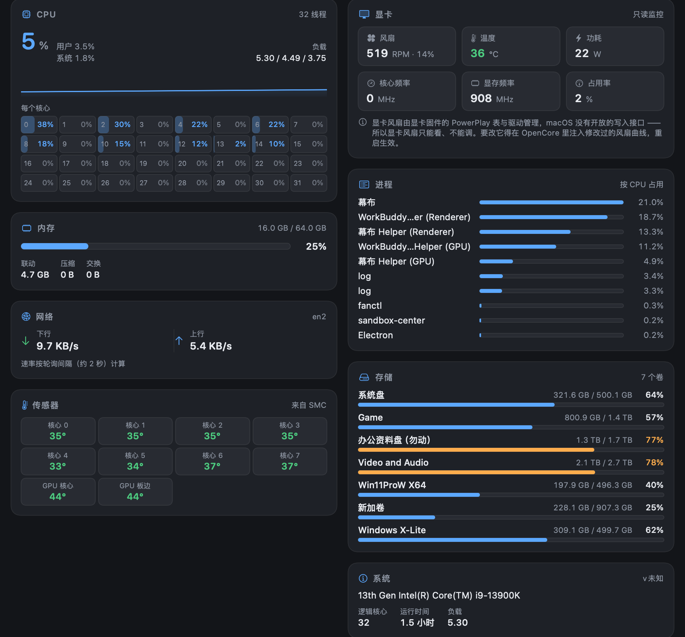
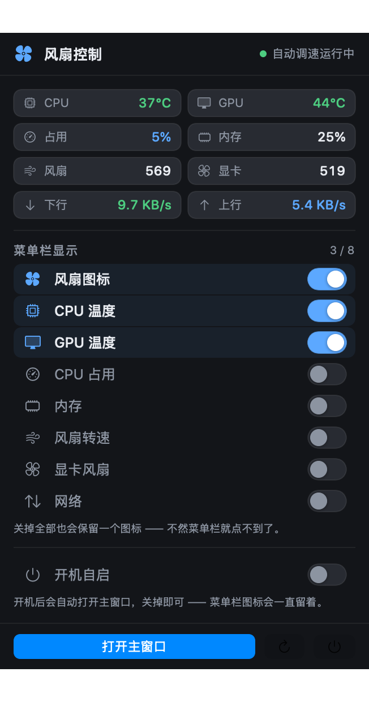

# FanControl

**macOS 下的主板风扇调速工具**（面向 Hackintosh）。

给主板 Super I/O 芯片 Nuvoton NCT679x 补上 SMC 写能力，让黑苹果也能按温度曲线调速 ——
安静 / 标准 / 性能 / 全速 / 手动 / 自定义曲线六种模式，外加只读的系统与显卡监控、菜单栏常驻显示。

> **English?** [Jump to the English section ↓](#english) ·
> Hackintosh motherboard fan control for macOS — a GUI front-end for [gpufan](https://github.com/shohart/gpufan)'s patched SMCSuperIO kext.
> *The GUI is currently Chinese-only.*


---

## 下载

👉 **[前往 Releases 下载最新版](https://github.com/glassecho/FanControl-macOS/releases)**

| 文件 | 给谁用 |
|---|---|
| **`FanControl-1.4.1.dmg`** | **普通用户装这个** —— 双击即可 |
| `FanControl-1.4.1.pkg` | 同上，也可以用命令行装 |
| `FanControl-1.4.1-src.zip` | 想自己编译的人 |

> ⚠️ 本软件**没有 Apple 开发者签名**（作者没有证书），Gatekeeper 会拦。
> 右键点安装包 → **打开** → 再点一次「打开」即可；
> 或到「系统设置 → 隐私与安全性」拉到底点「仍要打开」。

---

## 界面

| 控制页 · 标准 | 控制页 · 手动 |
|---|---|
|  |  |

| 控制页 · 自定义曲线 | 使用说明面板 |
|---|---|
|  |  |

| 监控页 | 监控面板 |
|---|---|
|  |  |

| 菜单栏面板 | 菜单栏上的样子 |
|---|---|
|  |  |

---

## 这个版本有什么

### 1.4.1

- **菜单栏面板里可以直接开关「开机自启」** —— 走系统的登录项机制（`SMAppService`），
  在「系统设置 → 通用 → 登录项」里也能看到和关掉，不用再手动加。
- 修了五处内部隐患：版本号改为单一来源、子进程管道死锁、传感器面板改为动态发现 CPU 核心、
  临时配置文件改用唯一文件名、发布版二进制不再包含本机开发路径。
- 完整改动见 [`CHANGELOG.md`](CHANGELOG.md)。

### 1.4.0

- **菜单栏常驻显示**：可任选「风扇图标 / CPU 温度 / GPU 温度 / CPU 占用 / 内存 / 风扇转速 /
  显卡风扇 / 网络」中的几项显示在菜单栏上，每项各自带图标，点图标弹出面板可随时增删。

### 1.3.0

- **新增「监控」页**：8 个可独立开关的面板 —— CPU（总占用 / 每核心 / 负载 / 走势图）、
  显卡、内存、存储、网络、进程、传感器、系统。开关会记住，全部只读、不需要 root。

---

## 适用条件

**三条硬门槛，缺一不可：**

| 条件 | 要求 |
|---|---|
| 系统 | **Hackintosh**（能改 OpenCore 的 `config.plist`）—— 真 Mac 不适用 |
| 主板 Super I/O | **Nuvoton NCT679x**：`NCT6790D`…`NCT6798D`、`NCT679BD`，或 `NCT6779D` |
| 架构 | **Intel**（kext 编译为 x86_64）—— Apple Silicon 不适用 |

macOS 13 / 14 / 15 / 26 均可。装完跑一次自检确认：

```sh
zsh /usr/local/sbin/fancontrol-check
```

---

## 组成

| 组件 | 语言 | 作用 |
|---|---|---|
| `app/` | Swift / SwiftUI | 图形界面。**不提权** |
| `helper/fanctl.c` | C | 特权辅助程序，**唯一**写 SMC 的入口 |
| `gpufand` | C | 温度 → 占空比守护进程，开机自启 |

> `gpufand` 与 `SMCSuperIO.kext` 来自 [gpufan](https://github.com/shohart/gpufan)
> （shohart，BSD 3-Clause），不在本仓库内。

---

## 安装

```sh
# 安装包
sudo installer -pkg FanControl-1.4.1.pkg -target /

# 或者从源码
zsh build.sh          # 需要 Xcode Command Line Tools
sudo zsh install.sh
```

**装完必须做两件事**（详见 [`移植说明.md`](移植说明.md)）：

1. 把 `/usr/local/share/fancontrol/SMCSuperIO.kext` 放进 `EFI/OC/Kexts`，
   替换同名文件，并在 `config.plist → Kernel → Add` 里注册 ——
   **它必须排在 `VirtualSMC.kext` 之后**（OpenCore 按顺序注入，依赖没就位的会被静默跳过）。
2. 确认水泵通道：`pump_channel` 默认是 `ch6`（作者本机布局），换机器必须核对。

---

## 构建

```sh
zsh build.sh            # x86_64 + arm64 通用二进制
zsh build.sh native     # 只编本机架构（快）
zsh make-pkg.sh         # 打成 .pkg + .dmg
```

预览界面（离屏渲染，不需要真的跑起来）：

```sh
swiftc -O -parse-as-library -target x86_64-apple-macos13.0 \
  -sdk "$(xcrun --show-sdk-path)" -o /tmp/render \
  app/Model.swift app/Views.swift render.swift \
  -framework SwiftUI -framework AppKit -framework Foundation
FANCTL_PATH="$PWD/helper/fanctl" /tmp/render preview
```

---

## 目录结构

```
app/            SwiftUI 源码（App / Model / Views / StatusItem）与 Info.plist、图标
helper/         fanctl.c（特权辅助程序）+ fancontrol-check（自检脚本）
tools/          图标生成工具（makeicon.swift）
build.sh        编译
make-pkg.sh     打包 pkg / dmg
install.sh      直接安装（等价于 pkg）
uninstall.sh    卸载
render.swift    离屏渲染预览工具
移植说明.md      面向用户的完整文档
CHANGELOG.md    更新日志
LICENSE         BSD 3-Clause
NOTICE          第三方组件归属声明
THIRD-PARTY/    gpufan 的许可证原文
```

---

## 设计要点

- **权限隔离**：界面不提权，只有 `fanctl` 需要 root。
  `/etc/sudoers.d/fancontrol` 只授权 `fanctl` 的五个子命令
  （`duty` / `rpm` / `bios` / `conf` / `daemon`），删掉即撤销。
- **不碰内核**：守护进程只通过 SMC 键操作，不与 kext 直接耦合，
  因此能和其他风扇软件共存（谁最后写谁生效）。
- **水泵硬锁**：默认通道不参与调速，界面上明确标出。

---

## 已知限制

- 显卡风扇**只能看、不能调** —— 由显卡固件的 PowerPlay 表 + 驱动管理，
  macOS 没有对外开放的写入接口。要改只能在 OpenCore 里注入软 PowerPlay 表。
- 真 Mac、Apple Silicon 不适用。
- 没有 Apple 开发者签名（作者没有证书），Gatekeeper 会拦。
- **界面目前只有中文**，英文界面在计划中（见 [Roadmap](#roadmap)）。

---

## 参与测试 / 反馈

作者手上只有一台机器（ASUS 主板 + NCT679BD），
特别希望有**不同主板、不同芯片**的朋友帮忙一起测。

愿意帮忙的话，请到 [Issues](https://github.com/glassecho/FanControl-macOS/issues) 反馈这几点：

1. 芯片型号 —— `ioreg -l -w0 | grep ChipName`
2. 自检结果 —— `zsh /usr/local/sbin/fancontrol-check`
3. 能不能调速（能不能拉到指定转速）
4. 水泵通道是几号，以及你是怎么判断的
5. 遇到的问题 —— 报错、崩溃、风扇异常行为，越具体越好

**已知的限制**（不用重复报）：

- 真 Mac、Apple Silicon 不适用
- 显卡风扇只能看、不能调
- 无驱动的显卡不显示显卡卡片
- 没有代码签名，需要手动放行

---

## Roadmap

- **英文界面** —— 目前界面文案是硬编码中文，计划做完整 i18n（跟随系统语言）。
- 更多 Super I/O 芯片的支持（目前只做 Nuvoton NCT679x / NCT6779D）。
- 更细的曲线编辑器（多段、可导入导出）。

---

## 许可证

[BSD 3-Clause](LICENSE)。

包含第三方组件，归属声明见 [NOTICE](NOTICE) 与 [THIRD-PARTY/](THIRD-PARTY/)：

- [gpufan](https://github.com/shohart/gpufan) —— Copyright (c) 2026, shohart，BSD 3-Clause
- [VirtualSMC / SMCSuperIO](https://github.com/acidanthera/VirtualSMC) ——
  Copyright (c) 2018 vit9696 / joedm，BSD 3-Clause

本项目与上述上游项目的作者无关，也未获得其背书。特此感谢 shohart 与 VirtualSMC 团队的工作。

---

## 免责声明

本软件会修改主板风扇转速，并需要你修改 EFI。**任何对 EFI / OpenCore 配置的修改
都有导致无法开机的风险**，请务必先备份。本软件按「原样」提供，不提供任何担保，
使用造成的损失作者不承担责任。**不要把水冷泵纳入调速。**

---
---

# English

**FanControl for Hackintosh** — motherboard fan control on macOS, with a Chinese GUI.

It gives hackintoshes the ability to control motherboard fans by temperature curve, by patching a gap in
VirtualSMC's SMCSuperIO. Six modes (silent / standard / performance / full / manual / custom curve),
plus read-only system and GPU monitoring and a menu-bar readout.

> **The GUI and documentation are in Chinese.** English UI is on the roadmap —
> English README contributions are very welcome.

## The problem

On a real Mac, fan control works because Apple's SMC exposes writable fan keys (`F0Md`, `F0Tg`, …).
Tools like Macs Fan Control and TG Pro read and write them directly.

On a hackintosh, motherboard fans hang off a Nuvoton SuperIO chip. VirtualSMC's SMCSuperIO plugin
registers their temperature and RPM as **sensor readings only** — it does not expose writable fan keys.
Without those keys, no SMC-aware tool can see the fans at all, no matter how good the tool is.
That is why *every* Mac fan-control app shows temperatures but refuses to control the fans on a hackintosh.

## What this does

It builds on [gpufan](https://github.com/shohart/gpufan), whose patched SMCSuperIO kext publishes the
SuperIO fan channels as standard Apple SMC fans. This project wraps that capability in a GUI:

- No command line, no hand-editing config files
- The GUI itself runs **unprivileged**; only a small helper (`fanctl`) writes to SMC, and
  `/etc/sudoers.d/fancontrol` authorizes just its five subcommands — delete the file to revoke
- Pump speed is **hard-locked** so it can't be accidentally throttled
- GPU fans are **read-only** — never written

## Requirements

- **Hackintosh** (you need to be able to edit OpenCore's `config.plist`) — not for real Macs
- Nuvoton **NCT679xD** or **NCT6779D** Super I/O chip (other chips stay read-only, same as upstream)
- **Intel** — the kext is built for x86_64; Apple Silicon is not supported
- macOS 13 / 14 / 15 / 26
- OpenCore + VirtualSMC

## Download

See the [Releases](https://github.com/glassecho/FanControl-macOS/releases) page for `dmg` / `pkg` / source.

There is **no Apple Developer signature** (the author has no certificate), so Gatekeeper will block it.
Right-click the installer → **Open** → **Open** again. Or go to
System Settings → Privacy & Security and click **Open Anyway**.

## Install

```sh
sudo installer -pkg FanControl-1.4.1.pkg -target /
```

Then run the self-check to confirm your chip is supported:

```sh
zsh /usr/local/sbin/fancontrol-check
```

**Two things you must do after installing** (see `移植说明.md`, Chinese):

1. Copy `/usr/local/share/fancontrol/SMCSuperIO.kext` into `EFI/OC/Kexts`, replacing the existing file,
   and register it in `config.plist → Kernel → Add`. **It must come after `VirtualSMC.kext`** —
   OpenCore injects in order, and a kext whose dependencies aren't in place yet is silently skipped.
2. Verify the pump channel. The default is `ch6` (the author's own layout) and **must** be re-checked
   on any other board.

## Why it needs the kext

Installing a kext into your EFI is a physical prerequisite for controlling motherboard fans on a
hackintosh. There is no way around it — the fan keys simply do not exist in SMC until SMCSuperIO
publishes them. If a tool claims to control motherboard fans on a hackintosh without touching the EFI,
it is either reading the GPU or it isn't working.

## Credits

Kext derived from [shohart/gpufan](https://github.com/shohart/gpufan) →
[VirtualSMC](https://github.com/acidanthera/VirtualSMC) (SMCSuperIO by vit9696, joedm). BSD-3-Clause.
See [`NOTICE`](NOTICE) and [`THIRD-PARTY/`](THIRD-PARTY/) for attribution.

This project is not affiliated with, or endorsed by, the upstream authors.
Thanks to shohart and the VirtualSMC team.

## Disclaimer

This software changes motherboard fan speeds and requires you to modify your EFI.
**Any change to your EFI / OpenCore configuration risks making the machine unbootable** — back up first.
Provided "as is", without warranty of any kind. **Do not put a water-cooling pump under speed control.**
